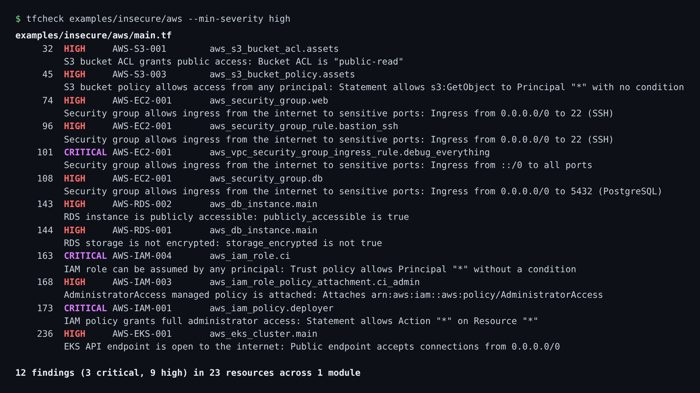

# terraform-misconfig-checker

[](https://github.com/DaveyD347/terraform-misconfig-checker/actions/workflows/ci.yml)


**`tfcheck`** is a static security scanner for Terraform. It catches the misconfigurations behind real cloud breaches (public buckets, SSH open to the world, unencrypted databases, `Action: "*"` IAM policies) in code review, before `terraform apply` ever runs.



- **46 rules** across AWS, Azure and Google Cloud, each with a description and a copy-paste fix ([rule reference](docs/rules.md))
- **Scans source or plans.** Point it at `.tf` directories, or at `terraform show -json` output for fully resolved values
- **Understands the code, not just the text.** A hand-written HCL2 parser and partial evaluator resolve variables, `tfvars`, locals, `jsonencode()`, `dynamic` blocks, `for` expressions and references between resources
- **Reports where the fix goes.** Findings point at the exact attribute line
- **Four output formats:** coloured text, JSON, SARIF 2.1.0 (GitHub code scanning) and Markdown (PR comments, job summaries)
- **Inline suppressions with reasons**, a config file, severity overrides, and CI-friendly exit codes
- **A GitHub Action** that annotates pull requests and uploads to the Security tab
- **Zero runtime dependencies.** Pure Python standard library

## Quick start

```bash
pip install git+https://github.com/DaveyD347/terraform-misconfig-checker
tfcheck path/to/terraform
```

Or from a clone:

```bash
git clone https://github.com/DaveyD347/terraform-misconfig-checker
cd terraform-misconfig-checker
pip install .
tfcheck examples/insecure
```

## What it catches

| Area | Examples |
|---|---|
| **Data exposure** | S3 public ACLs and `Principal: "*"` bucket policies, missing S3 Block Public Access, Azure containers open to anonymous reads, GCS buckets granted to `allUsers` |
| **Network** | Security groups, NSGs and GCP firewalls opening SSH, RDP, WinRM or database ports to `0.0.0.0/0` / `::/0` (critical when *every* port is open), public RDS/Redshift, public EKS endpoints, Cloud SQL authorized for the whole internet |
| **IAM** | `Action "*"` on `Resource "*"`, service-wide wildcards (`iam:*`), `Allow` + `NotAction`, AdministratorAccess attachments, role trust policies anyone can assume, primitive GCP owner/editor roles, public project IAM |
| **Encryption** | Unencrypted EBS, RDS, EFS, OpenSearch, SNS, SQS, ElastiCache in transit, plain HTTP listeners, TLS 1.0/1.1 policies, storage accounts allowing HTTP or old TLS |
| **Logging and resilience** | Single-region CloudTrail, no log file validation, KMS rotation off, S3 versioning off, RDS backups disabled, Key Vault purge protection off |
| **Credentials** | IMDSv1 left enabled (SSRF to credential theft), default compute service account with `cloud-platform` scope |

Run `tfcheck rules` to list them all, or `tfcheck explain AWS-IAM-004` for details and the fix.

Hardcoded secrets are deliberately out of scope; pair tfcheck with a dedicated secrets scanner.

## How it works

```
 .tf files ──► HCL2 lexer/parser ──► partial evaluator ──┐
 (+ tfvars)    (src/tfcheck/hcl.py)   (evaluator.py)     │
                                                         ├──► resource model ──► rules ──► text / JSON / SARIF / Markdown
 terraform show -json ──► plan loader (plan.py) ─────────┘    (model.py)        (rules/)
```

1. **Parse.** `hcl.py` is a dependency-free HCL2 parser covering blocks, every expression form, string templates, heredocs and all comment styles. Every node keeps its line number.
2. **Evaluate.** `evaluator.py` folds what can be known statically: variable defaults, `terraform.tfvars`, `*.auto.tfvars`, `--var-file`/`--var`, locals, conditionals, `for` expressions and ~35 built-in functions. Anything only known after apply becomes `UNKNOWN`, and references to other resources become `Ref` objects.
3. **Model.** Both source and plans are normalised into the same shape Terraform uses in its own JSON (attributes as values, nested blocks as lists), so each rule works on both inputs.
4. **Check.** Rules are small Python generators. They follow references to link resources (a public access block to its bucket, a role to its `aws_iam_policy_document`) and never flag a value that is unknown, which keeps false positives down.

### Source mode vs plan mode

| | Source (`tfcheck dir/`) | Plan (`tfcheck plan.json`) |
|---|---|---|
| Needs `terraform init` / credentials | No | Yes |
| Line numbers and inline suppressions | Yes | No (findings use resource addresses) |
| Module inputs, `count`/`for_each`, remote data | Partly (defaults and tfvars) | Fully resolved |

Use source mode on every pull request and plan mode in the pipeline that already runs `terraform plan`:

```bash
terraform plan -out tfplan
terraform show -json tfplan > tfplan.json
tfcheck tfplan.json
```

## Usage

```
tfcheck [scan] [PATHS...] [options]
tfcheck rules [--provider aws|azure|gcp] [--format text|json|markdown]
tfcheck explain RULE-ID
```

| Option | Description |
|---|---|
| `-f, --format text\|json\|sarif\|markdown` | Output format (default `text`) |
| `-o, --output FILE` | Write the report to a file |
| `--sarif-file FILE` | Also write SARIF, whatever `--format` is |
| `--fail-on SEVERITY` | Exit 1 if unsuppressed findings at or above this remain (`low` by default, `none` never fails) |
| `--min-severity SEVERITY` | Hide findings below this severity |
| `--skip RULES` / `--only RULES` | Comma-separated or repeated rule IDs |
| `--exclude GLOB` | Skip matching directories or files |
| `--var-file FILE`, `--var NAME=VALUE` | Variable values, applied after `terraform.tfvars` and `*.auto.tfvars` |
| `--config FILE` / `--no-config` | Use a specific config file, or ignore `.tfcheck.toml` |
| `--show-suppressed` | Include suppressed findings in text output |
| `--github` | GitHub Actions annotations, job summary and step outputs |

**Exit codes:** `0` clean, `1` findings at or above `--fail-on`, `2` usage or parse error (other files are still scanned and reported).

### Suppressing a finding

Some findings are intentional. Suppress them in the code, next to the resource, with a reason the reviewer can see:

```hcl
# tfcheck:ignore=AWS-LAMBDA-001 Public by design: Stripe webhook, signature verified in code
resource "aws_lambda_function_url" "webhook" {
  function_name      = "stripe-webhook"
  authorization_type = "NONE"
}

resource "aws_db_instance" "reporting" {
  publicly_accessible = true # tfcheck:ignore=AWS-RDS-002 read replica for the BI vendor, IP-allowlisted
  # ...
}
```

- A comment directly above a block, or at the top of its body, covers the whole resource.
- A trailing comment covers its own line; a comment on its own line covers the line below.
- Omit the rule IDs (`# tfcheck:ignore`) to suppress every rule for that scope.
- Suppressed findings stay in JSON and SARIF output (as SARIF `inSource` suppressions), so they remain auditable.

### Configuration

Drop a `.tfcheck.toml` in the repository root ([full example](.tfcheck.example.toml)):

```toml
fail_on = "high"
skip_rules = ["AWS-S3-004"]
exclude_paths = ["examples", "**/sandbox/**"]

[severity_overrides]
"AWS-EC2-003" = "high"
```

## GitHub Action

```yaml
name: Terraform security
on: [pull_request]

permissions:
  contents: read
  security-events: write   # only needed for upload-sarif

jobs:
  tfcheck:
    runs-on: ubuntu-latest
    steps:
      - uses: actions/checkout@v4
      - uses: DaveyD347/terraform-misconfig-checker@v1
        with:
          path: infra
          fail-on: high
          upload-sarif: true
```

Findings appear as inline annotations on the pull request, as a Markdown table in the job summary, and in the repository's Security tab. Inputs: `path`, `fail-on`, `skip-rules`, `rules`, `exclude`, `var-files`, `config`, `sarif-file`, `upload-sarif`, `python-version`. Outputs: `findings`, `critical`, `high`, `medium`, `low`, `sarif-file`. All inputs reach the shell through environment variables, never through template interpolation, so they can't inject commands.

## Sample output

The [`examples/`](examples) folder holds deliberately insecure AWS, Azure and GCP configurations, a hardened AWS baseline that scans clean, and a plan file:

- [`docs/sample-output.txt`](docs/sample-output.txt): text report
- [`docs/sample-report.md`](docs/sample-report.md): Markdown report as it appears in a job summary
- [`docs/sample-report.json`](docs/sample-report.json): JSON
- [`docs/sample-report.sarif`](docs/sample-report.sarif): SARIF 2.1.0

The plan in `examples/plan/tfplan.json` is a hand-written, trimmed example in the documented `terraform show -json` format (it includes a child module, `count` instances, `after_unknown` values and configuration references), so it can be committed without cloud credentials.

## Development

```bash
pip install -e ".[dev]"
pytest              # 200+ tests: parser, evaluator, every rule (positive and negative), CLI, plans, examples
ruff check . && ruff format --check .
python scripts/gen_rules_doc.py   # regenerate docs/rules.md after changing rules
```

Adding a rule is one decorated function in `src/tfcheck/rules/<provider>.py`:

```python
@rule(
    "AWS-EFS-001",
    "EFS file system is not encrypted",
    Severity.MEDIUM,
    ["aws_efs_file_system"],
    """EFS encryption at rest can only be chosen at creation time.""",
    """encrypted = true""",
)
def efs_encryption(r: Resource, m: Module):
    value = r.config.get("encrypted")
    if not is_true(value) and value is not UNKNOWN:
        yield Issue("encrypted is not true", "encrypted")
```

Then add an insecure and a secure snippet to `CASES` in `tests/test_rules.py` (a test fails if a rule has none).

## Limitations

- Source mode evaluates each module directory on its own, using its variable defaults and tfvars. Values passed in from a calling module aren't propagated; scan the plan for those.
- Resources declared with `count` or `for_each` are checked once, with `count.index` and `each.*` unknown.
- Rules cover the most common, highest-impact misconfigurations rather than every provider setting. It's meant to complement broader tools, not replace them.

## License

[MIT](LICENSE)
